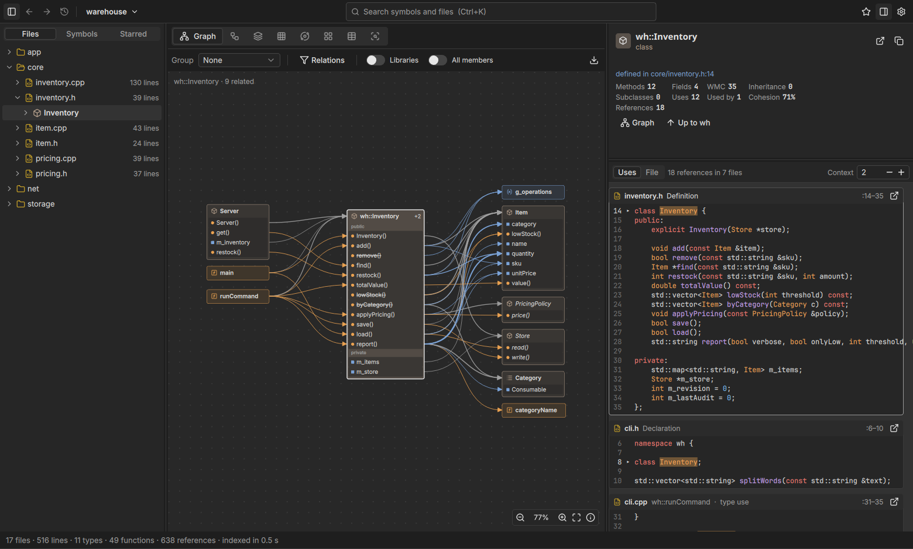

# Unravel

See the architecture, flows and connections of C, C++ and Python code: what a
class is made of and what it touches, how control flows from `main`,
which modules lean on which, where the cycles, the duplicates and the
complexity are. Built for reviewing and understanding code you didn't
write yourself — especially code an assistant wrote.

**[Website](https://iam-peter.github.io/unravel/)** ·
**[Download](https://github.com/iam-peter/unravel/releases)** ·
[Nightly](https://github.com/iam-peter/unravel/releases/tag/nightly)



clang does the understanding. Unravel parses every translation unit with
libclang, exactly as your build compiles it (from `compile_commands.json`),
and keeps every declaration, reference, call, include, inheritance and
override it reports. On top of that it measures function bodies, finds
duplicated code, cycles and dead code, and shows it all in views taken
from the tools that did this best: [Sourcetrail](https://github.com/CoatiSoftware/Sourcetrail)'s
graph and code views, and the hierarchical edge bundles, treemaps,
table lenses and dependency matrices of
[SolidSX and CPPVis](https://webspace.science.uu.nl/~telea001/SoftVis/CPPVis).

Python goes through the same model and the same views. Python's own `ast`
module reads every `.py` file under the project (nothing is imported or
run): modules become namespaces, with their classes, functions, methods,
fields and module variables, the imports between them, inheritance and
overrides, and the calls it can resolve — names in scope, imports,
`self` and `super()`, parameters and variables with a type annotation or
a constructor call, and fields assigned such values. A mixed project gets
both front ends at once.

Qt 6 (C++ and Qt Quick), with the controls, themes and fonts of
[Cache](../cache) and [igitt](../igitt).

## Download

Each [release](https://github.com/iam-peter/unravel/releases) has:

| File | For |
|---|---|
| `unravel-windows-x64-setup.exe` | Windows 10/11: installer, no administrator rights needed |
| `unravel-windows-x64.zip` | Windows 10/11 without installing: unzip, start `unravel.exe` |
| `unravel-macos.dmg` | macOS on Apple silicon |
| `unravel-linux-x64.AppImage` | any Linux |
| `unravel-linux-x64.deb` | Debian and Ubuntu, with its own Qt and clang |

Each brings `unravel-cli` beside the program, its own libclang and clang's own headers (`stddef.h`,
the intrinsics). The C and C++ standard library comes from a compiler on your system, as it does for
your build: gcc or clang on Linux, Visual Studio or its Build Tools on Windows, the Xcode command line
tools on macOS. Python projects need `python3` on the path.

The programs aren't signed: Windows SmartScreen asks once (*More info*, *Run anyway*). macOS blocks
the first start; then choose *Open Anyway* under System Settings › Privacy & Security. Step-by-step
guides for every system are on the [website](https://iam-peter.github.io/unravel/#installation).

**Nightly and releases.** Every night with new commits, the [Nightly](.github/workflows/nightly.yml)
workflow builds and tests on Linux, Windows and macOS, smoke-tests the packages (indexing the sample
with the clang they bring, and showing the window) and replaces the rolling `nightly` pre-release.
*Promote Release* (run by hand with a version) turns the current nightly into a stable release with
the same files. [CI](.github/workflows/ci.yml) builds and tests every push and pull request; the
[website](pages/) is published from `pages/` by the *Website* workflow.

## The views

All views share one *active symbol*. Clicking anything — a node, a
member, a name in the code, a row, a finding — makes it the active one
everywhere; Alt+Left and Alt+Right, or the mouse's thumb buttons as in a
browser, go back and forth.

| View | What it shows |
|---|---|
| **Graph** (Ctrl+1) | Sourcetrail's view. The active symbol in the middle with its members grouped by access; what uses it on the left, what it uses on the right, base classes above, subclasses below. Uses within the class are brackets beside the members. Edges are coloured by kind (calls, type uses, variable uses, inheritance, overrides, macros), thick by count; click one for the references behind it. Libraries are hatched and hidden unless asked for; more than 24 neighbours on a side fold into “n more”. Group by namespace or file. Export as SVG or PNG. |
| **Flow** (Ctrl+2) | How control flows. On the left a call tree in the order of the code (or who calls it), unfolding on demand, with virtual dispatch to every override and recursion marked. On the right the same calls as a layered graph to any depth — or every call path from the function to another one. |
| **Architecture** (Ctrl+3) | The architecture as it is: modules (folders, to any depth), files or classes, layered so dependencies sit below what uses them. Cycles in red. Beside it each module's coupling after Robert C. Martin (afferent, efferent, instability, abstractness, distance from the main sequence) with the main-sequence chart. |
| **Matrix** (Ctrl+4) | A dependency structure matrix of modules, files or classes, ordered so dependencies come first: in a layered design everything is below the diagonal, cycles are framed in red. Click a cell for its references. |
| **Bundles** (Ctrl+5) | Holten's hierarchical edge bundles: folders, files and their classes and functions on a circle, every dependency inside it bundled along the hierarchy, green at the user and red at the used. Point at a node for only its own. |
| **Treemap** (Ctrl+6) | Folders, files and what is written in them, area by lines (or statements), colour by complexity, callers, uses, nesting, findings or “looks unused”. Double-click to zoom into a folder. |
| **Metrics** (Ctrl+7) | A table lens of every function, class, file and module: lines, McCabe and cognitive complexity, nesting, parameters, callers, callees; methods, weighted methods, inheritance depth, coupling and cohesion of classes. Bars for each value's share, review thresholds in red. Copies as CSV. |
| **Review** (Ctrl+8) | What deserves a reviewer's attention, each with why it matters and a link to its code. Exported as a Markdown report for a pull request, a ticket or an assistant. |
| **Changes** (Ctrl+9) | Only the code that chosen commits changed. Pick commits from the git history (Ctrl adds one, Shift a range), or the uncommitted changes; their changed lines are carried forward to the files as they are now and mapped to the classes, functions, fields and macros they are in. The graph shows those with their changed members (new ones in green, changed in yellow, with the number of lines) and how they use each other — optionally with what uses them, the change's reach, and what they use. Beside it the changed symbols, files and the review's findings in the change, exported as Markdown. Every other view marks the changed members, and the code view the changed lines. |

Beside every view: the active symbol's **details** (signature, where it
is, its measurements, what the review says about it) and the **code**,
as in Sourcetrail — the definition first, then every place that uses it
with the lines around, each under the function it is in. Every name
clang resolved is a link. Or the whole file.

**Folding.** Any folder can be folded into one node — third-party code, generated code, a subsystem
you aren't reviewing — and everything that uses something in it then points at that node. Fold from
the project tree or a node's context menu (right-click), or with *Fold → Fold third-party code*, which
finds folders such as `3rdparty`, `third_party`, `vendor` or `external`. Folded folders apply to the
Graph, Architecture, Matrix and Bundles views, are kept per project, and open again with a click on
their node, from the menu or the tree.

In the Graph, neighbours from another namespace (or Python module) than the active symbol's fold into
one node per namespace, `ns:: 4 folded: …`, when there are two or more of them; a click opens it, its
context menu folds it again, and *Fold namespaces* in the toolbar turns this off.

Everything is drawn on the GPU through Qt Quick's scene graph: the edges as one vertex buffer per
colour, the bundles, treemap and matrix as coloured meshes with scene-graph text, so panning,
scrolling and zooming only move a transform and hovering redraws only what it highlights. They can be curved, straight or at right angles
(*Settings*, or the button beside the zoom).

On the left the **project**: folders, files and what they declare, or the
namespaces; bookmarks (Ctrl+D). **Search** (Ctrl+K) is fuzzy over every
symbol and file (`inv::rep` finds `Inventory::report`).

### Historical file metrics

**Metrics → Files** adds Git commit counts, added and removed lines, distinct
authors (resolved through `.mailmap`), and the last change date. Compare the
existing complexity column with commit frequency to find review hotspots.
**Treemap → Colour → Git churn (files)** colors whole files by touching commits;
it does not attribute file history to individual functions.

The history bar selects UTC calendar days (180 by default, remembered per
project), an editable revision (initially `HEAD`), and offers **Refresh** and
**Cancel** without reindexing. Counts cover non-merge commits reachable from that
revision, filtered by committer time, not just the 500 commits in Changes.
Uncommitted edits are excluded. History is **pathname-based** by default:
renames count as a deletion at the old name and an addition at the new one;
earlier history is not carried across the rename. Opt into **Follow renames**
for Git's slower, per-current-file `--follow` heuristic; it is not proof of
identity through copies, splits, or refactoring. Deleted paths remain in
pathname statistics but are not current files in a rename-following query.

Shallow clones are labeled partial. Missing or failed history is shown as
unavailable, not zero; binary changes have unknown line totals. The file-table
CSV includes the revision, time bounds, coverage, and pathname policy. Git must
support `--since-as-filter`; failed, oversized (over 128 MiB), or timed-out
(two-minute) queries report an error rather than displaying incomplete totals.
Results are cached on disk separately from the code index. Keys include the
repository, resolved revision, UTC window, Git/algorithm version, identity
mapping, graph metadata, and rename policy. Corrupt caches are reported and
recomputed. **Refresh** bypasses the result cache; Git metadata is checked even
on a cache hit. Rename following has an additional two-minute traversal budget.
**Blame active code** loads up to 80 current source lines on demand, showing
commit, contributor, and summary. This is worktree attribution against `HEAD`,
independent of the selected history window/revision; uncommitted lines are
marked `worktree`. Closing the dialog cancels the bounded background request.

### Review Focus

**Review > Review Focus** ranks the top 20 defined project functions, with
whole-project, touched-function, and bounded potential-dependent scopes.
Potential reach follows static dependencies, not proven execution impact.
Show all, select a row to navigate, or copy Markdown/JSON with the components:

```text
C = max(1, McCabe/15, cognitive/25)
H = log2(1 + file touching commits)
D = log2(1 + distinct incoming/outgoing symbol neighbours)
priority = C * (1 + H) * (1 + 0.25 * D)
```

This is **heuristic v1, not a defect probability**. History is explicitly a
file-level proxy, not historical function churn. Static priority omits H;
the summary identifies when no history is used. Contributor counts do not
multiply the score. Existing findings and severity remain in **Findings**.
Metrics adds function priority and maximum function priority per file; Treemap
adds priority coloring. Their scope labels and CSV metadata retain the policy.

### Architecture contracts and header impact

**Review > Architecture rules** reads optional
`.unravel/architecture.json` from the project root. For example:

```json
{
  "version": 1,
  "layers": [
    { "id": "ui", "name": "UI", "paths": ["src/ui/**"] },
    { "id": "database", "name": "Database", "paths": ["src/database/**"] }
  ],
  "rules": [
    { "id": "ui-no-database", "from": "ui", "to": "database",
      "effect": "forbid", "scope": "semantic" }
  ],
  "exceptions": []
}
```

Use `scope: "includes"` for include rules. Unlisted pairs are allowed;
an explicit allow overrides a forbid for the same pair/scope. Ambiguous layer
assignments and malformed/unknown configuration fields are errors. Exceptions
name `id`, `rule`, root-relative `source` and `target` paths, and a nonempty
`reason`. The panel exposes unassigned files, rule IDs, source evidence, and
JSON/Markdown reports. Architecture edges and Matrix cell outlines mark
violations in orange, separately from red cycles. Without a rule file,
observed dependency views behave as before.

**Review > Header impact** ranks project headers by distinct reachable indexed
translation units, with witness include chains, cycle evidence, and an
expandable include-only graph. Treemap adds a header-impact file color mode.
These are **partial indexed-configuration estimates, not measured build
times**: aggregated include facts may combine configurations, and paths through
external/generated files, PCH, header units, or modules can be absent.
The CLI report bounds ranking to 20 headers and witnesses to 50 units per
header, reporting truncation explicitly.

### Relationships, Qt events, and experimental compiler flow

**Flow > Relationships** provides depth-bounded callers/callees,
subclasses/implementors, overrides, readers/writers, and cross-module
dependencies, with an explicit 1,000-symbol limit. Function-address references
are not direct calls or recursion; source references label address-taking and
possible virtual dispatch distinctly.

**Flow > Qt events** records statically resolved typed `QObject::connect`
endpoints, sender/context expressions, delivery type, and source evidence.
Connections describe **potential delivery**, not immediate calls. Lambdas have
navigable locations; string/unresolved targets are marked incomplete.
Thread affinity, disconnects, receiver lifetime, dynamic invocation, and QML
connections prevent execution guarantees. Cached indexes rebuild when their
serialized format is incompatible.

**Flow > Control flow (experimental)** uses an optional `unravel-flow`
helper beside the application executable. It emits real Clang basic blocks
and successor edges from a compilation database, never an invented CFG from
the call graph. Select a function definition in a listed translation unit;
the selector uses its exact definition start line. Missing helper/database,
unsupported selection, timeouts, and limits produce explanations.
The source-linked block/successor diagram is limited to 150 blocks and 400
edges; larger results retain their block evidence without a truncated diagram.

Exception paths, implicit destructor edges, unreachable successors, and
coroutines are not modeled; header-only definitions outside a listed
translation unit are unsupported. Experimental facts expose explicit enum
assignments with **unknown prior state**, and compiler-derived pointer/reference
type shapes with **unknown ownership/lifetime**. They are not validated state
machines or ownership graphs. Local data-flow slicing is deliberately a
**no-go** until aliasing, call effects, and branch-join rules are validated.

## What the review looks for

- **Parse errors**: files clang couldn't compile cleanly, so the picture of them may be incomplete
- **Include, module and class cycles**, and **recursion** (direct or through other functions)
- **Complex functions** (McCabe and cognitive complexity), **long** ones, **deep nesting**, **many parameters**
- **Large classes**: many methods, much logic (weighted methods), many dependencies, low cohesion
- **Duplicated code**: functions with the same token structure (names and literals made alike), and near
  duplicates by MinHash over token shingles — the helper written three times
- **Possibly unused** functions, methods, types, macros and globals. Qt's meta-object system is taken into
  account: slots, signals, `Q_INVOKABLE`, `Q_PROPERTY` accessors, `Q_ENUM`s and QML types count as used
- **Written, never read** fields and variables
- **Mutable global state** with the functions that write it
- **Deep inheritance**, and polymorphic bases whose **destructor isn't virtual**
- **Large files**, and **files nothing builds** (sources no translation unit compiles, headers nothing includes)

Thresholds are those of common practice (complexity 15, cognitive 25, 80 lines, nesting 4, 6 parameters…);
see `Analysis::Thresholds` in [src/core/analysis.h](src/core/analysis.h).

## Opening a project

Open a folder (Ctrl+O), a `compile_commands.json`, or drop either on the
window; from a terminal `unravel path/to/project`. Unravel then

1. uses the `compile_commands.json` in the folder or one of its build folders (CMake with
   `-DCMAKE_EXPORT_COMPILE_COMMANDS=ON`, Meson, `bear -- make` all write one);
2. or, for a CMake project without one, runs `cmake` to write one into its cache (with the Qt it was
   built with on the prefix path, so Qt projects configure);
3. or compiles every source under the folder with the include paths where the headers are, and Qt's when
   the code includes Qt headers.

Python files under the folder are read as well (with `python3`, which must be on the path), skipping
virtual environments, `site-packages`, `__pycache__`, build trees and hidden folders.

Parsing runs on all cores (up to 12); the index is kept in the cache folder, so the next start is
instant, and the status bar says when the sources changed since. Extra compiler arguments for a project
go in the settings. Build trees inside the project count as *generated*: indexed for their uses (moc's
calls of slots), left out of the architecture views and the review.

The editor that “open in editor” (Ctrl+E) starts is set in the settings, with `{file}` and `{line}`
(`code -g {file}:{line}` by default).

## Building

Requires Qt ≥ 6.9, CMake ≥ 3.21 and libclang from LLVM 17 or newer (`libclang-dev` on Debian and Ubuntu,
`llvm` from Homebrew, LLVM's `clang+llvm-…-windows-msvc` archive on Windows). `UNRAVEL_LLVM_ROOT`
points CMake at an LLVM it doesn't find by itself; on Windows the build copies `libclang.dll` and clang's
headers next to the programs. A package puts clang's headers beside the program, where the indexer looks
for them (`lib/clang/<major>`, `../lib/clang/<major>` or `../Resources/clang/<major>`), or
`UNRAVEL_CLANG_RESOURCE_DIR` names them.

```bash
cmake -B build -G Ninja -DCMAKE_PREFIX_PATH=$HOME/Qt/6.12.0/gcc_64
cmake --build build
ctest --test-dir build --output-on-failure
./build/bin/unravel samples/warehouse
```

The CFG helper is OFF by default and does not add Clang C++ linkage to the
normal application/core. To build it, install matching LLVM/Clang development
libraries (including libclang-cpp), then configure with
`-DUNRAVEL_ENABLE_FLOW=ON -DUNRAVEL_LLVM_ROOT=/path/to/llvm`.
The helper was validated with LLVM 18; its C++ API is version-coupled.
Its QtCore, libclang, libclang-cpp, LLVM, and builtin-header runtime dependencies
must remain available. Relocatable optional-helper packaging has not been
validated; default release packaging is unchanged.

`samples/warehouse` is a small program with known flaws (layers that depend on each other, a helper
written three times, a base without a virtual destructor, global state, dead code) to try it on.

For daily use, install a release build next to the debug one in `build/`; it goes into `~/.local` with
an entry in the application menu, and finds the Qt and libclang it was built against:

```bash
cmake -S . -B build-release -G Ninja -DCMAKE_BUILD_TYPE=Release -DCMAKE_INSTALL_PREFIX=$HOME/.local -DCMAKE_PREFIX_PATH=$HOME/Qt/6.12.0/gcc_64
```

```bash
cmake --build build-release && cmake --install build-release
```

Run the second command again to update it.

### The command line

`unravel-cli` indexes without the window, for scripts and CI:

```bash
./build/bin/unravel-cli path/to/project --report review.md      # the review as Markdown
./build/bin/unravel-cli path/to/compile_commands.json --dump    # every symbol and relation
./build/bin/unravel-cli path/to/project --save index.idx        # the index, to --load later
./build/bin/unravel-cli path/to/project --focus review-focus.md --focus-json focus.json
./build/bin/unravel-cli path/to/project --revision main --history-days 90 --follow-renames --focus-json -
./build/bin/unravel-cli path/to/project --static-focus --focus-json static-focus.json
./build/bin/unravel-cli path/to/project --architecture .unravel/architecture.json --architecture-json rules.json --fail-on-architecture
./build/bin/unravel-cli path/to/project --include-impact headers.json
```

Architecture violations exit **3** only with `--fail-on-architecture`;
configuration errors exit **2**. `--architecture-json` without an explicit
configuration uses the project's `.unravel/architecture.json`. Choose only one
stdout (`-`) report per invocation, without `--dump`. CLI historical Focus
fails explicitly if Git is unavailable; opt into `--static-focus` instead.

`unravel --grab shot.png --view architecture --symbol ns::Class project` saves a screenshot of a view;
`unravel --view changes --commits a1b2c3d,worktree project` opens on the code those commits changed;
`--fold vendor,src/generated` folds folders on start. `UNRAVEL_PAN_BENCH=1` pans the visible graph and
prints the time per frame.

## How it is made

- [src/core](src/core) — the engine, Qt Core and libclang only:
  - `model` — files, symbols (by clang's USR), references, the aggregated edges; saving and loading
  - `project` — finding and reading the compilation database, cleaning compiler arguments for clang
  - `indexer` — libclang's indexer callbacks on worker threads, one index per thread. Each project header
    is indexed by the first unit that includes it with a given set of defines, so a header included by
    hundreds of units is read once per configuration; macros (and macros used in macros) from the
    preprocessing record; body metrics and clone signatures. `UNRAVEL_TIMING=1` prints where the time went
  - `analysis` — dependency graphs at three levels, strongly connected components, Martin's metrics,
    class metrics, call trees and paths, the findings
  - `layout` — a layered (Sugiyama) layout and a squarified treemap
  - `report` — the Markdown review
  - `python` — the Python front end: a script embedded in the binary (`python/unravel_python.py`, using
    only `ast` and `tokenize`) run with `python3 -I`, its JSON merged into the model with `py:` USRs
  - `history` — the git log and diffs (with the git command line), changed lines carried forward to the
    work tree and mapped to symbols
- [src/app](src/app) — what the QML uses: the `Session` (opening, indexing, the active symbol, history,
  bookmarks), list and tree models, the graph scenes, and the painted views (edges, bundles, treemap,
  matrix)
- [qml](qml) — the window and the views
- [style](style) — igitt's Qt Quick Controls style and themes, unchanged, as in Cache
- [packaging](packaging) — the Debian package, the Windows installer (Inno Setup) and the QML imports
  the deploy tools need to see; [logo](logo) has the icons per platform
- [pages](pages) — the website; [.github/workflows](.github/workflows) — CI, the nightly, releases and
  the website

## Limits

- What clang can't see, Unravel can't: code behind `#if`s the build doesn't take, calls through function
  pointers stored at run time, what QML, scripts or other programs call. “Possibly unused” is a list to
  check, not to delete.
- Calls of virtual methods are recorded to the method named; the flow view adds every override as a
  possible target.
- Templates are indexed as written, not per instantiation.
- Without a compilation database flags are guessed, and parse errors show where they were wrong.
- Python is dynamic: a call through a name whose type the code doesn't state is resolved only when
  exactly one method of the project has that name, `getattr`, monkey patching
  and decorators that replace functions are invisible, and what is imported from outside the project
  stays a name.

## License

MIT, see [LICENSE](LICENSE). Qt is used under the LGPL v3, clang and LLVM under the Apache License 2.0
with LLVM Exceptions; igitt's style (`style/`) is MIT; Inter and JetBrains Mono are under the SIL Open
Font License 1.1 and the Lucide icons under the ISC license (their license files are beside them).

## Credits

The ideas: Sourcetrail (Coati Software, GPL) for the graph and code views; Alexandru Telea's group
(SolidSX, CPPVis, Utrecht and Groningen) and Danny Holten for edge bundles, table lenses and treemaps.
clang and libclang (LLVM, Apache 2.0 with LLVM exception). Icons: Lucide (ISC). Fonts: Inter and
JetBrains Mono (SIL Open Font License). Style and themes: igitt.
